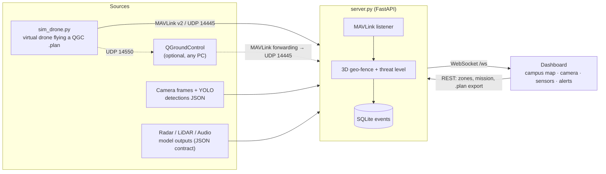

# AeroSense — Multi-Modal Drone Detection & Airspace Protection (FAST-NUCES Islamabad)

[](https://fastapi.tiangolo.com)
[](https://www.python.org/)
[](https://github.com/ultralytics/ultralytics)
[](https://mavlink.io)
[](https://docs.qgroundcontrol.com)

AeroSense is a final-year project that detects drones with **camera, radar, LiDAR and audio**
and protects a site — the **FAST-NUCES Islamabad campus (H-11/4)** — with a **3D geo-fence**.
It is a software-only, decision-support system: it detects, classifies, alerts and logs. It does
**not** jam or intercept drones.

## Mission: protect FAST campus airspace

| Zone | Type | Altitude band (AGL) | Meaning |
|---|---|---|---|
| Campus Buffer | monitoring | 0 – 200 m | approach area, observation only |
| FAST Campus Restricted Airspace | restricted | 0 – 120 m | entering = **BREACH** |
| Academic Block No-Fly Core | critical | 0 – 60 m | entering = **CRITICAL** |

A drone over the campus at 300 m is an *over-flight* (ADVISORY); the same drone descending below
120 m is a *BREACH*. This is 3D geo-fencing: polygon **and** altitude band.

**Threat levels:** `CLEAR → ADVISORY → WARNING → BREACH → CRITICAL`

* **ADVISORY:** the drone is inside the buffer, or flying over a zone above its ceiling.
* **WARNING:** the drone is approaching restricted airspace (it will reach it within 60 m or 20 s
  at its current altitude), or it is descending towards a zone's ceiling.
* **BREACH / CRITICAL:** the drone is inside a zone's polygon **and** within its altitude band.

Zone entry needs 2 consecutive samples (hysteresis), so GPS jitter on a boundary doesn't cause
alert spam. When YOLO sees the drone at the same time, the alert is marked **camera-confirmed**.

## Architecture



## Quick start (no extra installs)

```bash
pip install -r requirements.txt          # fastapi + uvicorn[standard] (+ ultralytics for detection)
python server.py --sim                   # server + built-in virtual drone over FAST campus
```

Open **http://127.0.0.1:8000/dashboard** and log in with `admin@gmail.com` / `12345678`.
Within about 90 seconds the intruder descends into campus airspace and the levels go
ADVISORY → WARNING → BREACH → CRITICAL. One loop of the mission takes about 5.5 minutes.

If you run the virtual drone as a separate process (closer to how a real drone works):

```bash
python server.py                         # terminal 1 — waits for MAVLink on UDP 14445
python sim_drone.py                      # terminal 2 — the "drone"
```

Other laptops on the same Wi-Fi can open `http://<server-laptop-IP>:8000/dashboard`.

## QGroundControl integration (without installing it on our laptops)

QGroundControl (QGC) is a ground-control station. It talks to drones using **MAVLink** and saves
missions and geofences as **`.plan`** JSON files. AeroSense speaks both, so QGC is optional:

| What | How AeroSense handles it |
|---|---|
| Telemetry protocol | `mavlink_lite.py` encodes/decodes MAVLink v2 (HEARTBEAT, GLOBAL_POSITION_INT, ATTITUDE, VFR_HUD, GPS_RAW_INT, SYS_STATUS). CRC_EXTRA values are verified against common.xml in the tests and cross-checked with pymavlink in CI |
| Missions | the dashboard planner reads/writes QGC `.plan` files. **Download .plan** gives a file that opens in QGC (Plan → Open). **Import .plan** loads a mission drawn in QGC |
| Geofence | restricted/critical zones are exported as QGC exclusion polygons in `geoFence.polygons` |
| Live data through QGC | on a PC with QGC: `python sim_drone.py --target <QGC_PC_IP>:14550`. QGC shows the drone. In QGC → Application Settings → MAVLink → **Enable MAVLink forwarding**, host `<server_IP>:14445`. QGC then forwards the telemetry to our server |
| Real drone / PX4 SITL | same as above: drone → QGC → forwarding → server. No code changes |

The server ignores heartbeats from ground stations (MAV_TYPE_GCS), so QGC's own heartbeat
is not mistaken for a drone.

## Dashboard

* **Overview:** the camera feed with YOLO boxes; a live campus map (satellite imagery when online,
  vector-only when offline) showing the zones, flight path, drone heading, a track coloured by threat
  level, and the camera field of view from the sensor mast; a threat assessment card; MAVLink
  telemetry; altitude vs zone ceilings; a radar plan-position indicator; LiDAR range; the audio
  classifier; and the event log.
* **Mission & Geo-fence Planner:** drag zone vertices onto the real campus boundary, add vertices,
  draw new zones, set altitude bands, add waypoints, and export/import QGC `.plan` files.
  The virtual drone reloads a saved mission automatically.
* **Sensor Fusion, Tracked Targets, Alerts (SQLite), Command & Control, Analytics.**

> **First thing to do:** the campus polygon is an approximate ~15-acre square around the campus
> centre (33.65645 N, 73.01641 E). Open the Planner on a laptop with internet, switch to
> satellite view, drag the vertices onto the real boundary and press **Save zones**.

## Plugging in radar, LiDAR and audio models

Each model writes one JSON file. The server replays it on the same clock and puts the detections
on the map:

```
data/radar/radar_tracks.json      data/lidar/lidar_tracks.json      data/audio/audio_detections.json
```

```json
{ "sensor": "lidar", "coordinate_frame": "sensor_xyz",
  "detections": [ {"t": 0.0, "x": 41.2, "y": -3.5, "z": 18.0, "confidence": 0.93, "track_id": 1} ] }
```

`coordinate_frame` can be:

* `sensor_xyz`: x forward, y left, z up — the MMAUD/ROS convention. The sensor's compass heading
  is set in `data/site_config.json`.
* `polar`: range / azimuth / elevation.
* `enu`
* `wgs84`
* `none`: for audio, e.g. `{"t":..,"drone":true,"confidence":..}`.

To convert a model's CSV output:

```bash
python tools/convert_sensor_output.py lidar_preds.csv --sensor lidar --frame sensor_xyz
python tools/convert_sensor_output.py radar.csv --sensor radar --frame polar --col t=timestamp --col confidence=score
```

A missing or broken file never crashes the server. That panel just shows `NO MODEL OUTPUT`.

## Camera pipeline (unchanged contract)

`make_detections.py` runs the YOLO weights over the frames and writes the per-frame contract
(`{"frame.jpg": {"drone": true, "confidence": 0.74, "box": [x, y, w, h]}}`). `server.py` replays
it at `PLAYBACK_FPS`.

To choose a different clip:

```bash
python server.py --sim --frames data/test_frames/Mavic_3 --detections data/Mavic_3_detections.json
```

## API

| Endpoint | Method | Purpose |
|---|---|---|
| `/dashboard` | GET | operator dashboard |
| `/ws` | WS | `hello`, `frame`, `telemetry` (5 Hz, includes geofence + sensors), `event`, `zones`, `mission` |
| `/api/telemetry` | GET | latest MAVLink state + geofence status |
| `/api/zones` | GET / PUT | geofence zones (stored as GeoJSON in `data/geofence/`) |
| `/api/mission` | GET / PUT | mission (QGC `.plan` or `{waypoints:[…]}`) |
| `/api/export/plan` | GET | download the QGC `.plan` (mission + geofence) |
| `/api/events` | GET | event history from SQLite |
| `/api/operator-action` | POST | log an operator action (audit trail) |
| `/`, `/health`, `/info`, `/frame/{i}`, `/detection/{i}` | GET | as before |

## Tests

```bash
pip install pytest httpx pymavlink       # httpx/pymavlink only needed for 2 optional test files
python -m pytest -v
```

The tests cover:

* geodesy accuracy and point-in-polygon, including concave polygons
* zone validation and the GeoJSON round-trip
* every threat level, hysteresis, and approach warnings with time-to-breach
* MAVLink CRC/CRC_EXTRA, stream parsing, corruption resync, MAVLink v1, and a pymavlink cross-check
* the full intruder scenario reaching all 5 levels through the codec
* real UDP output from the virtual drone
* sensor adapters
* the server API and WebSocket

## Repository structure

```text
server.py              FastAPI server: camera replay, MAVLink listener, geofence, APIs, WebSocket
sim_drone.py           virtual drone (MAVLink over UDP) flying a QGC .plan
mavlink_lite.py        dependency-free MAVLink v2 codec
geofence.py            3D zones, threat classification, events
geo.py                 WGS84 / ENU / polar conversions, polygon maths
qgc_plan.py            QGroundControl .plan read/write
sensor_adapters.py     radar / LiDAR / audio replay contract
test_dashboard.html    operator dashboard
static/aeromap.js      lightweight offline-capable map engine (canvas, Web Mercator)
data/site_config.json  campus centre, sensor mast position, sensor settings
data/geofence/         fast_campus_zones.json (GeoJSON)
data/missions/         fast_intruder_demo.plan (QGroundControl format)
tools/                 build_campus_demo.py, convert_sensor_output.py
make_detections.py     YOLO inference → detections JSON
tests/                 pytest suite (run in GitHub Actions)
```

## Honest scope notes (for the report / viva)

* **Data replay, not physics simulation.** Camera frames and model outputs are recorded data
  replayed on a timeline. The intruder's position comes from a virtual drone that sends standard
  MAVLink. A real drone or PX4 SITL can replace it without code changes.
* The camera clips were **not filmed at FAST**. They demonstrate the detector. The map position
  comes from MAVLink (and, when added, radar/LiDAR).
* The campus boundary and ground elevation (~510 m MSL) are **approximate** until corrected in
  the Planner.
* "Response" means alerting, recommending and logging (decision support). Interception and jamming
  are out of scope.

## Team

* **Member 1:** camera frames + YOLO weights.
* **Member 2:** server, MAVLink and geofence.
* **Member 3:** radar/LiDAR models → JSON contract, and the dashboard.

*AeroSense — Final Year Project, FAST-NUCES Islamabad.*
