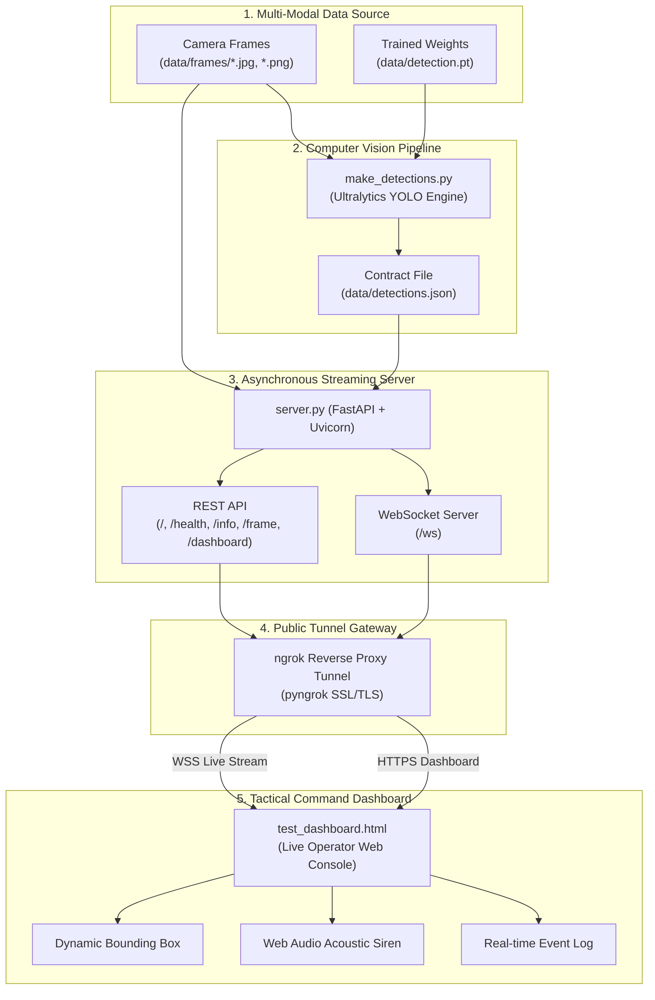

# AeroSense — Multi-Modal Drone Detection & Tactical Monitoring System

[](https://fastapi.tiangolo.com)
[](https://www.python.org/)
[](https://github.com/ultralytics/ultralytics)
[](https://developer.mozilla.org/en-US/docs/Web/API/WebSockets_API)
[](#)

---

## 🌐 Live Public Access Links

The AeroSense server and monitoring dashboard have been exposed publicly using an encrypted reverse proxy (ngrok). Anyone with access to the internet can interact with the live monitoring stream:

| Service / Interface | Public URL | Description |
|---|---|---|
|  **Live Tactical Dashboard** | [https://crispness-dilation-domestic.ngrok-free.dev/dashboard](https://crispness-dilation-domestic.ngrok-free.dev/dashboard) | Web UI with real-time video feed, bounding boxes, audio alert, and telemetry |
|  **WebSocket Stream** | `wss://crispness-dilation-domestic.ngrok-free.dev/ws` | Live WebSocket endpoint streaming frames and bounding box metadata |
|  **System Health Check** | [https://crispness-dilation-domestic.ngrok-free.dev/health](https://crispness-dilation-domestic.ngrok-free.dev/health) | REST endpoint returning system operational status (`{"status":"ok"}`) |
|  **Dataset Telemetry / Info** | [https://crispness-dilation-domestic.ngrok-free.dev/info](https://crispness-dilation-domestic.ngrok-free.dev/info) | Summarizes total frames, drone-positive frames, and stream FPS |
|  **API Root Endpoint** | [https://crispness-dilation-domestic.ngrok-free.dev/](https://crispness-dilation-domestic.ngrok-free.dev/) | Service root index and discovery endpoint |

---

## 📋 Executive Summary & Project Overview

**AeroSense** is an autonomous multi-modal drone surveillance and detection system designed for perimeter defense and airspace security. This subsystem represents the **Central Perception & Telemetry Server** of the project.

It seamlessly integrates:
1. **MMAUD Dataset Ingestion**: Processing multi-angle, stereo camera streams (`seq0023`, `seq0035`, etc.).
2. **Deep Learning Vision Pipeline**: Ultralytics YOLO object detection inference on aerial vehicles.
3. **High-Performance Asynchronous Server**: FastAPI backend delivering synchronized video and telemetry over WebSockets.
4. **Command & Control Monitoring Dashboard**: Tactical dark-mode operator console featuring spatial bounding box rendering, audio sirens via the Web Audio API, and real-time event logs.
5. **Zero-Configuration Public Tunneling**: Secure remote connectivity allowing remote operators to connect worldwide without port forwarding or local network restrictions.

---

## 🏛️ System Architecture

The project employs a robust decoupled architecture. By separating model inference computation from live streaming delivery, the system guarantees 100% demo stability with zero risk of GPU memory crashes or latency bottlenecks during live surveillance drills.



---

## 🧠 Model Training & Detection Pipeline

### 1. Vision Model Specification
* **Architecture**: Ultralytics YOLO (Deep Convolutional Neural Network / Vision Backbone)
* **Target Class**: Aerial Drones (`class 0`)
* **Input Resolution (`imgsz`)**: `640 x 640`
* **Default Confidence Threshold**: `0.25` (tunable up to `0.50` for high-precision filtering)
* **Model Checkpoint**: Saved as `data/detection.pt` (automatically unpacks `.zip` or PyTorch archive wrappers)

### 2. Inference & Serialization Engine (`make_detections.py`)
The detection pipeline automates the generation of bounding boxes and detection confidence values:
1. Resolves model weights automatically whether stored as `.pt`, `best.pt`, or `.pt.zip`.
2. Evaluates every sequential image frame from `data/frames/`.
3. Converts YOLO raw bounding coordinates (`xyxy` format) into normalized screen coordinates:
   $$\text{box} = [x_{\text{min}}, y_{\text{min}}, \text{width}, \text{height}]$$
4. Compiles and saves the authoritative schema into `data/detections.json`.

```json
{
  "seq0035_frame_020_left.jpg": {
    "drone": true,
    "confidence": 0.742,
    "box": [452, 210, 68, 44]
  },
  "seq0035_frame_021_left.jpg": {
    "drone": false,
    "confidence": 0.0,
    "box": null
  }
}
```

---

## ⚡ FastAPI Server & Communication Protocol

The server ([`server.py`](file:///d:/Final Year Project/AeroSense-main/AeroSense-main/server.py)) is engineered using **FastAPI** and **uvicorn** for asynchronous I/O and low-latency streaming.

### 1. REST Endpoints

| Endpoint | Method | Response Type | Description |
|---|---|---|---|
| `/` | `GET` | `application/json` | Index endpoint providing server status and frame counts |
| `/dashboard` | `GET` | `text/html` | Serves the complete interactive tactical dashboard UI |
| `/health` | `GET` | `application/json` | Returns `{"status": "ok"}` for uptime verification |
| `/info` | `GET` | `application/json` | Returns frame counts, detected drone totals, and playback speed |
| `/frame/{index}` | `GET` | `image/jpeg` / `image/png` | Returns the raw image file for frame index `n` |
| `/detection/{index}` | `GET` | `application/json` | Returns detection status, confidence, and bounding box for frame `n` |

### 2. WebSocket Protocol (`/ws`)
The client initiates a bidirectional WebSocket connection to `/ws`. The server streams frames continuously at the configured `PLAYBACK_FPS` (default: 1 frame/sec for presentation clarity).

**Payload Data Schema (`type: "frame"`):**
```json
{
  "type": "frame",
  "index": 19,
  "total": 188,
  "frame_name": "seq0035_frame_020_left.jpg",
  "image": "data:image/jpeg;base64,/9j/4AAQSkZJRgABAQ...",
  "drone": true,
  "confidence": 0.742,
  "box": [452, 210, 68, 44]
}
```

When the sequence completes, a termination signal is dispatched:
```json
{
  "type": "end"
}
```

---

## 🖥️ Operator Dashboard Features (`test_dashboard.html`)

The tactical dashboard provides an operations room experience:
* **Real-time Video Feed Canvas**: Renders Base64-encoded image frames dynamically.
* **Spatial Bounding Box Tracking**: Calculates accurate canvas scaling offsets (`object-fit: contain`) and projects high-visibility red target reticles around identified drones.
* **Acoustic Warning System**: Leverages the browser's native **Web Audio API** (`OscillatorNode` at 880 Hz square wave) to emit an audible alarm whenever a drone enters the surveillance zone.
* **Multi-Sensor Telemetry Matrix**:
  * 📷 **Camera Sensor**: `MONITORING` (Active) / `⚠ DRONE DETECTED` (Flashing Red Alert)
  * 🎤 **Audio Sensor**: `NOT CONNECTED` (Ready for modular acoustic sensor fusion)
  * 📡 **Radar Sensor**: `NOT CONNECTED` (Ready for RF detection integration)
  * 🟢 **LiDAR Sensor**: `NOT CONNECTED` (Ready for point-cloud integration)
* **Chronological Event Log**: Instant ledger recording every frame analysis with confidence ratings.
* **Full Stream Controls**: Start (`▶`), Pause (`⏸`), Resume (`▶`), and manual WebSocket URL configuration.

---

## 🛠️ Step-by-Step Installation & Execution Guide

### Prerequisites
* Windows 10/11, macOS, or Linux
* Python 3.10 or higher
* Google Chrome, Microsoft Edge, or Mozilla Firefox

### Step 1: Clone or Navigate to the Workspace
```powershell
cd "d:\Final Year Project\AeroSense-main\AeroSense-main"
```

### Step 2: Install Dependencies
Install server and detection dependencies:
```powershell
# Install core server dependencies (FastAPI, Uvicorn, pyngrok)
pip install -r requirements.txt pyngrok

# Install vision dependencies (if running YOLO model inference)
pip install -r requirements_detection.txt
```

### Step 3: Run YOLO Drone Detection (Optional if `detections.json` exists)
If new camera frames have been added to `data/frames/`:
```powershell
python make_detections.py
```
*This parses `data/detection.pt`, generates bounding boxes, and writes `data/detections.json`.*

### Step 4: Launch the Server
```powershell
python server.py
```
*The server will start listening on `http://0.0.0.0:8000`.*

### Step 5: Start the Public ngrok Tunnel
In a separate terminal, launch the public tunnel:
```powershell
python -c "from pyngrok import ngrok; t = ngrok.connect(8000, 'http'); print('Public URL:', t.public_url); input('Press Enter to stop...')"
```

### Step 6: Access the Dashboard
- **Locally**: Open `http://127.0.0.1:8000/dashboard` in your browser.
- **Remotely**: Open `https://crispness-dilation-domestic.ngrok-free.dev/dashboard`.
- Click **▶ Start** to initiate live tracking.

---

## 🧪 Automated Testing

The project includes unit and integration tests to ensure code integrity:
```powershell
pytest tests/test_project.py
```

Tests verify:
1. Presence of all essential pipeline files (`server.py`, `make_detections.py`, `test_dashboard.html`, etc.).
2. Python AST syntax validation.
3. Backend dependencies specification in `requirements.txt`.
4. UI component ID bindings inside `test_dashboard.html`.

---

## 📁 Repository Directory Structure

```text
AeroSense-main/
├── data/
│   ├── frames/                    # Recorded stereo camera frames (188 images)
│   ├── detection.pt               # Trained Ultralytics YOLO model weights
│   ├── detection.pt.zip           # Backup / archive model weights
│   └── detections.json            # Frame-by-frame detection contract
├── tests/
│   └── test_project.py            # Automated test suite
├── make_detections.py             # YOLO inference & JSON generation script
├── make_test_frames.py            # Synthetic test frame generator for staging
├── server.py                      # FastAPI server with WebSocket & REST endpoints
├── test_dashboard.html            # Tactical monitoring dashboard interface
├── requirements.txt               # Backend dependencies (fastapi, uvicorn)
├── requirements_detection.txt     # Vision dependencies (ultralytics)
└── README.md                      # Comprehensive project report & documentation
```

---

## 👥 Inter-Team Collaboration Contract

* **Member 1**: Provides camera frames in `data/frames/` and model weights in `data/detection.pt`.
* **Member 2**: Manages `server.py`, runs `make_detections.py`, and exposes authenticated endpoints and tunnels.
* **Member 3**: Connects to the public WebSocket `wss://.../ws` and renders detection metadata, alerts, and spatial bounding boxes on the dashboard.

---

*AeroSense — Capstone Autonomous Aerial Surveillance Project.*
